# It's a My Money! 💰

A personal finance app built with Expo. Track your income, expenses, transfers, and account balances — all data stored locally on your device. Cloud backup is opt-in and only stores data in your own Google Drive.

> **Platform support:** Android is fully supported. iOS is **not yet supported** — if you'd like to help test or contribute to iOS support, check the [issues](https://github.com/itsmariodias/its-a-my-money/issues) or open a new one!

> Vibe coded by [@itsmariodias](https://github.com/itsmariodias) with [Claude Code](https://claude.ai/code) (Anthropic). Every screen, component, and feature in this app was built through a conversation with Claude — no manual coding required.

---

## What it does

**Dashboard**
- Total balance and period income/expense summary
- Charts carousel — swipe between three charts in one card:
  - **Spending by Category** — animated donut chart; tap a slice to highlight it
  - **Cash Forecast** — your cash balance over the last 90 days, projected 90 days ahead as a dashed line. The projection adds your scheduled recurring items on their dates, entries you've already dated in the future, and your average day-to-day spending over the last 90 days. Investment accounts are left out, since there's no history of their market value to project from
  - **Income vs Expenses** — monthly bars for the last 6 months (or the whole year in year view), with average saved per month and savings rate. Tap a month for its in, out, and net. With one account selected, its transfers in and out show as grey caps on the bars
- Portfolio allocation donut — per-investment-account slices sized by invested amount, with live P&L % beside each
- Investment breakdown — with a single investment account in view, the donut splits its value into invested vs. profit (or what's left vs. loss), with the return % in the centre
- Recent transactions list
- Filter by account or time period (day, month, year)
- Multi-currency aware — when no account filter is active, aggregates are scoped to your primary currency (no FX conversion); the currency code shows in the balance card

**Transactions**
- Full transaction history grouped by date
- Tap a row to edit; delete from inside the edit sheet
- Amount field follows the selected account — pick a rupee account and the field switches to ₹, whatever your default currency is
- Filter by account and time period
- Section totals per day — one subtotal per currency when a day mixes accounts in different currencies, never a blended number
- Category filter chips — tap one or more to narrow the list; Transfers chip appears when an account is selected
- Group by category view — see per-category totals sorted by amount, expand each row to drill into individual entries. Categories holding more than one currency show a subtotal per currency

**Transfers**
- Move money between accounts with a dedicated transfer sheet
- Save & Add Another for entering multiple transfers in one session
- Cross-currency transfers — pick accounts in different currencies and the sheet reveals a second "Amount received" field. No FX rate ever invented; you type both sides

**Accounts**
- Manage multiple wallets (Cash, Bank, Credit Card, etc.) across any of 44 currencies
- Each account has a name, icon, color, currency, and initial balance — currency is set per-account at creation
- Tap to edit; delete from inside the edit sheet. Linked transactions cascade-delete; transfers are kept and the deleted side renders as "Unknown"
- Running balance calculated from initial balance + net transactions
- Total Balance card is a swipeable carousel — one page per currency, primary currency leads (no cross-currency conversion)
- P&L stats — percentage change vs. previous period shown on each account card and total balance
- Investment accounts — track fixed deposits, mutual funds, trades alongside cash. Invested amount auto-computed from transfers and transactions; current market value is user-editable. P&L on each investment card is live market value vs. invested

**Budgets**
- Set spending limits per expense category — weekly, monthly, or yearly, in any currency
- Each budget tracks its own period independent of the Dashboard filter
- Currency-scoped spend — a USD food budget only counts expenses on USD accounts; same category in another currency is a separate budget
- Dashboard card with one row per budget: progress bar, percent used, spent vs. limit
- Color-coded status — green under 80%, amber 80–99%, red at or over 100%
- Local notification when a transaction pushes a budget over its limit
- Pace warning — when your spending so far, plus bills and recurring expenses still due, would take a budget over its limit before the period ends, the card says so: "On pace for €620 — over by ~Oct 20"
- Manage from Settings — add, edit, delete; deleting a category removes its budget too

**Goals**
- Savings buckets inside an account — set money aside for an emergency fund, a trip, or a new laptop without moving it anywhere
- Each goal has a name, icon, colour, and target, plus an optional target date with a countdown badge ("5 months left") and a "$375/month to reach it on time" hint
- Three ways money moves: put part of an income toward goals as you record it, pay an expense from a goal, or add and release money by hand
- Reserved · Available under your balances (Dashboard, Accounts tab, goals list), so you can see what's actually free to spend. Future-dated income can't be reserved before its day
- Mark a goal as complete — it keeps its history and frees the money
- Local notifications when a goal reaches its target, and when spending dips into money set aside for goals
- Dashboard card with progress for each active goal; manage from Settings or the card

**PDF Statements**
- Settings → Data → Export Statement — all accounts or one, for the last 12 months, this month, this year, last year, or any custom range
- A bank-style, print-friendly A4 PDF: per-currency income and spending by category, then each account's opening balance, every transaction and transfer with a running balance, and its closing balance
- Saved straight to your export folder on Android; opens the share sheet on iOS

**Cloud Backup**
- Automatic Google Drive backup — daily, weekly, or monthly
- Uses the same JSON format as manual export
- Single file in a dedicated Drive folder, overwritten each backup
- OS notifications when backup starts and completes
- Connect/disconnect from Settings with one tap

**Recurring Transactions & Transfers**
- Define repeating income, expenses, or transfers between accounts — subscriptions, rent, salary, bills, monthly savings sweeps
- Frequencies: daily, weekly, monthly, quarterly, yearly
- Transactions and transfers are auto-generated on app open for any missed due dates
- Set an optional end date; entries gray out when expired
- Manage from Settings — add, edit, delete with optional cleanup of past entries
- Auto-generated entries appear in the transaction list with a recurring indicator

**Settings**
- Currency picker (44 currencies) — sets the default for new accounts, budgets, and goals
- Theme — 4 presets (Sky Blue, Starry Blue, White, OLED Black) plus Auto modes that follow the system light/dark setting
- Accent color — 19 color presets
- Number format — US, European, French, Indian, or no-grouping
- Date format — DD/MM/YYYY, MM/DD/YYYY, YYYY-MM-DD, DD MMM YYYY, or MMM DD, YYYY
- Biometric lock — fingerprint/Face ID to protect the app
- Show P&L Stats toggle — enable/disable percentage change indicators on the Accounts tab
- Manage income and expense categories (add, edit, delete)
- Manage recurring transactions and transfers
- Manage budgets
- Manage goals
- Export all data as JSON (includes theme preference)
- Export a PDF statement for any account and date range
- Import from JSON backup or Monefy CSV
- Full data reset

---

## Tech stack

- [Expo](https://expo.dev) (managed workflow)
- [expo-router](https://expo.github.io/router) — file-based navigation
- [expo-sqlite](https://docs.expo.dev/versions/latest/sdk/sqlite/) — local SQLite database, all data on-device
- [Zustand](https://zustand-demo.pmnd.rs) — global state management
- [@react-native-google-signin/google-signin](https://github.com/react-native-google-signin/google-signin) — Google OAuth for Drive backup
- [expo-notifications](https://docs.expo.dev/versions/latest/sdk/notifications/) — local backup notifications
- [expo-local-authentication](https://docs.expo.dev/versions/latest/sdk/local-authentication/) — biometric lock
- TypeScript throughout

All data is stored locally on your device. Cloud backup to Google Drive is optional and user-initiated.

---

## Running locally

```bash
# Install dependencies
pnpm install

# Start the dev server
pnpm start

# Run on iOS simulator
pnpm ios

# Run on Android emulator
pnpm android
```

### Environment setup

Copy `.env.example` to `.env.local` and fill in your Google OAuth credentials:

```bash
cp .env.example .env.local
```

Google Drive backup requires OAuth client IDs from the [Google Cloud Console](https://console.cloud.google.com/). Create OAuth 2.0 credentials for Web, iOS, and Android clients with the `drive.file` scope.

### Development builds

Native modules (Google Sign-In, notifications) require a development build — Expo Go is not supported. Use [EAS Build](https://docs.expo.dev/develop/development-builds/create-a-build/) to create one:

```bash
npx eas-cli build --profile development --platform android
```

Install the resulting APK/IPA on your device, then run `pnpm start` and scan the QR code.

---

## Screenshots

<div align="center">

| Dashboard | Cash forecast | Income vs. expenses |
| :---: | :---: | :---: |
| 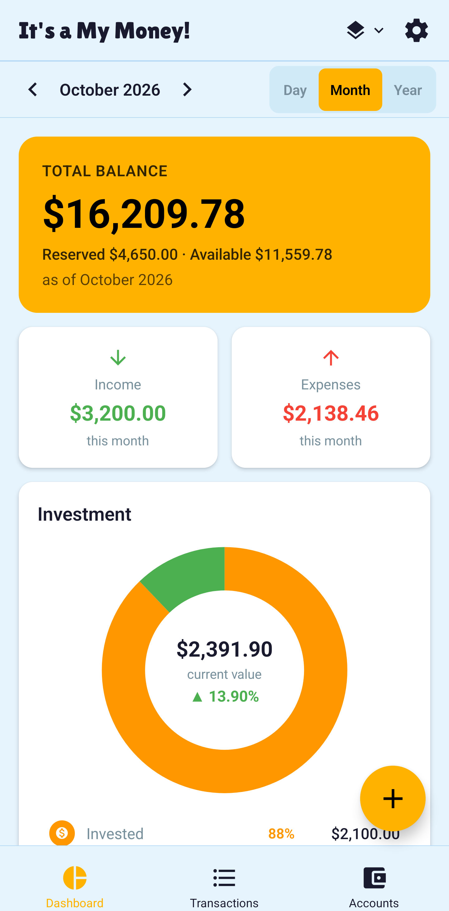 | 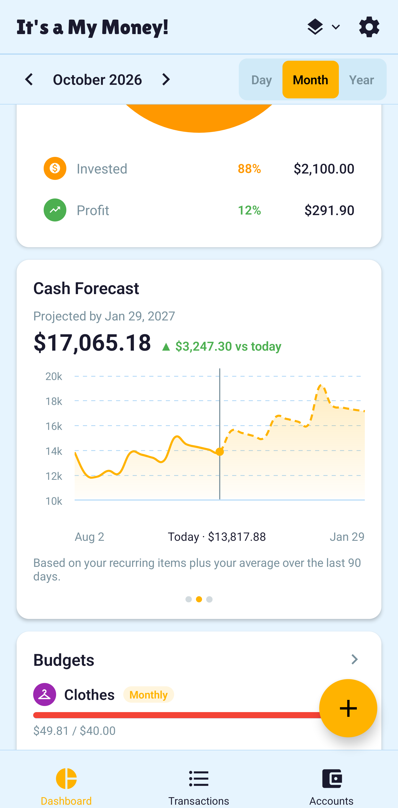 | 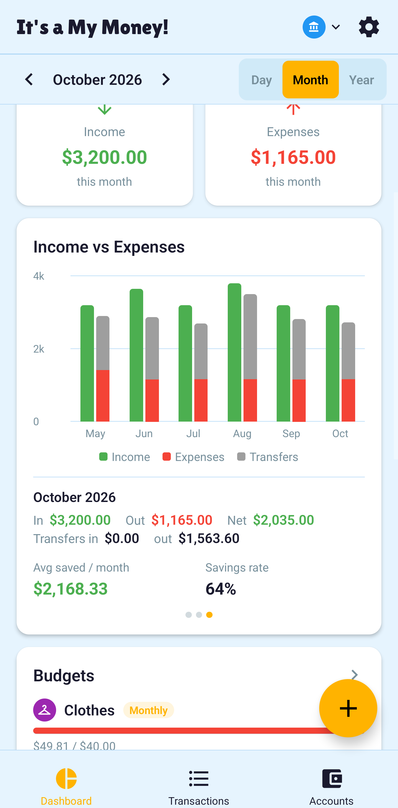 |
| **Investment breakdown** | **Budgets & goals** | **Accounts** |
| 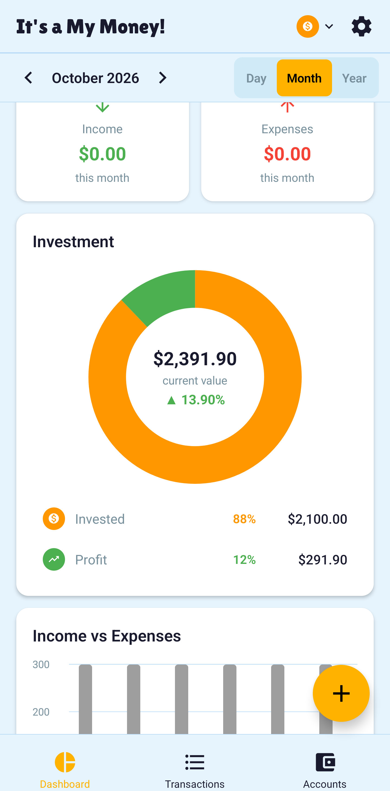 | 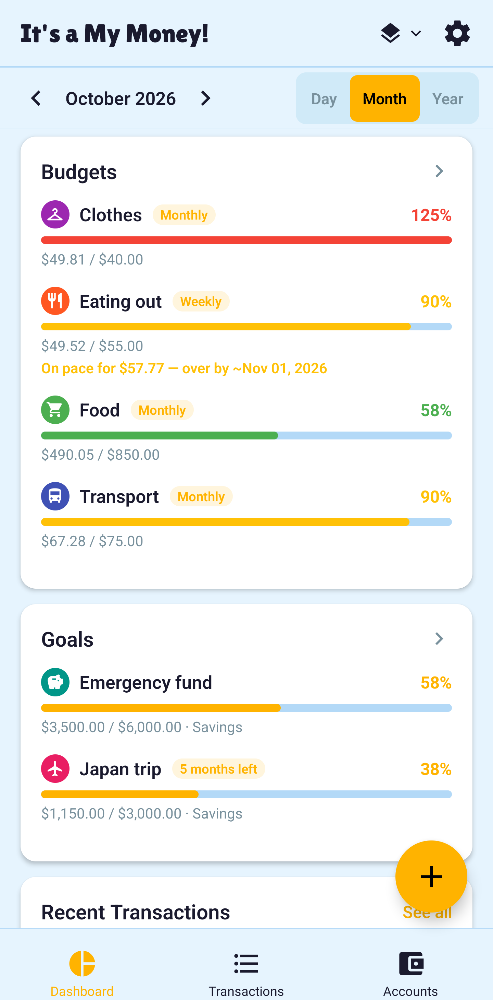 | 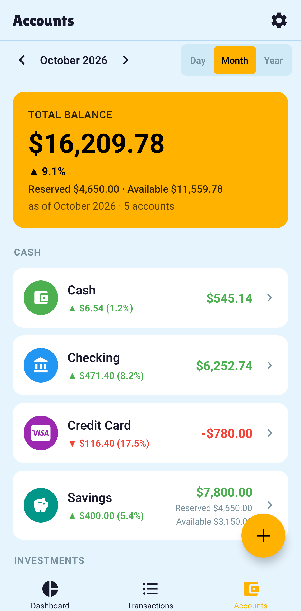 |
| **Goals** | **Put income toward goals** | **Transactions (grouped)** |
| 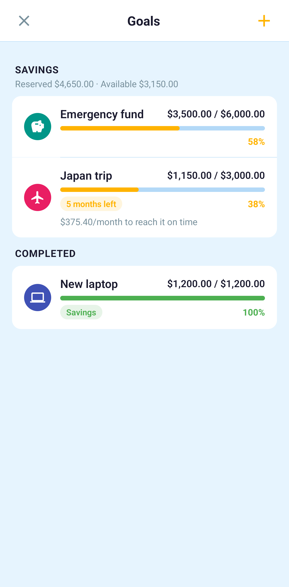 | 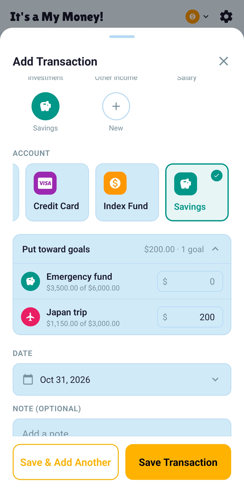 | 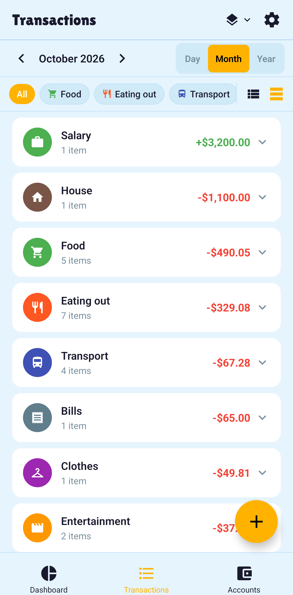 |
| **Add transaction** | **Settings** | **Cross-currency transfer** |
| 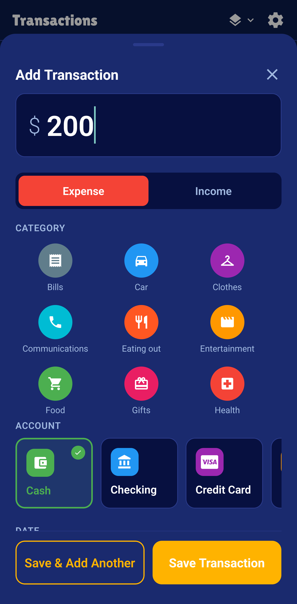 | 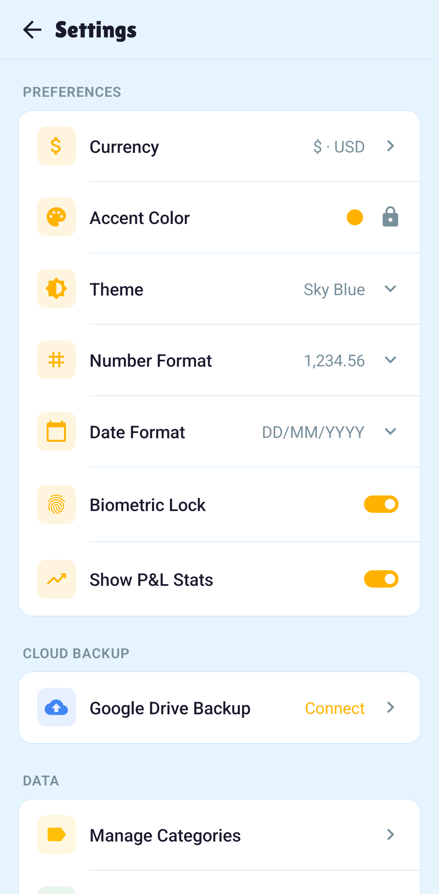 | 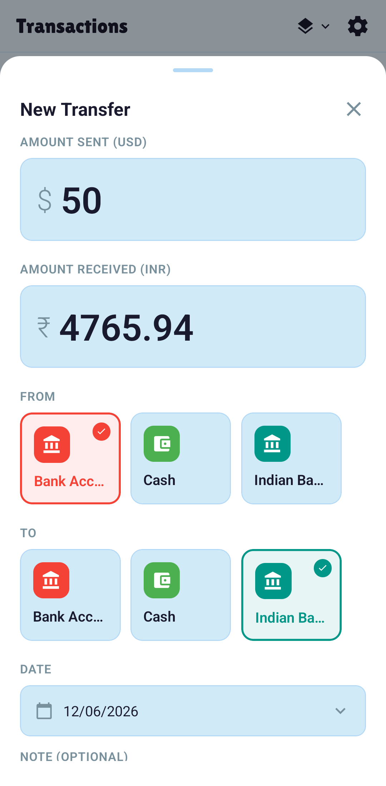 |
| **Theme picker** | **PDF statement** | |
| 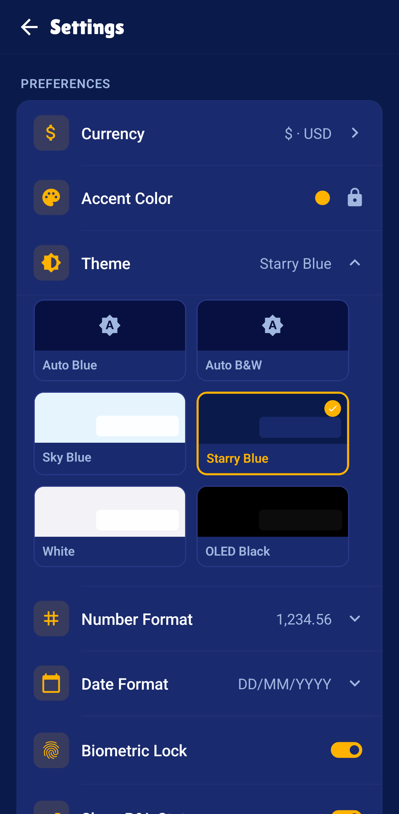 | 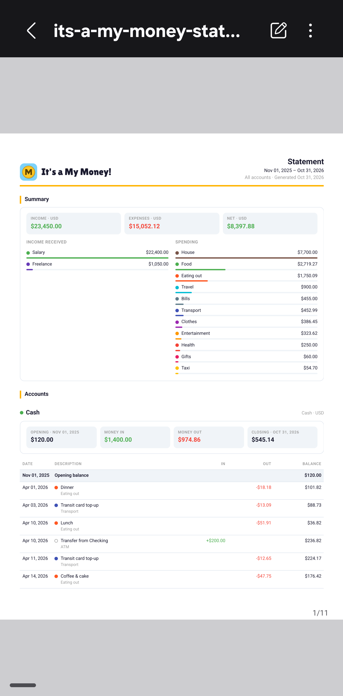 | |

</div>

---

## About

Built by [@itsmariodias](https://github.com/itsmariodias) as a personal project.

This app is 100% vibe coded — designed and built entirely through back-and-forth conversation with **Claude Code** by Anthropic, without writing a single line of code manually. Claude handled the architecture, components, database schema, state management, UI, and everything in between.
